# sapai arena: design doc and build log

As of 14 Nov 2026 · branch `claude/wizardly-feynman-dhzi7b` (merged into `main` in batches after play-testing)

## Overview

sapai arena is a browser game on top of the sapai engine. You play an auto-battler pet game against trained reinforcement-learning models, or watch two agents play each other. It runs locally with Python and numpy: `python -m gui.server`, then open http://127.0.0.1:8405.

**Goals**

- Play the trained models in a real game instead of a terminal.
- Watch the models battle and see why they make each move.
- Trust the engine: every rule change is visible in a log and checked by tests.
- Make it fun to look at and listen to, for a new player as much as for us.

**Headline milestones**

| Milestone | Result |
| --- | --- |
| First win against Charlie's greedy bot | Won |
| Charlie vs Token net 16.8M, the strongest model (rated 1470) | Charlie won with 1 life left: 4 wins, 3 losses, 4 draws over 11 turns |

The models are MaskablePPO agents trained on the `claude/beautiful-planck-gdftka` branch (see `models/README.md`).

## The journey

The game went from a terminal prompt to a 3D battle viewer in one long build session on 14 Nov 2026, driven by what turned up while playing. Newest first:

| # | Step | What happened |
| --- | --- | --- |
| 25 | Replay catalog | Every game is kept with its full history in a Replays tab: list, search, rename, step through any turn |
| 24 | Design doc | This file, after the first wins |
| 23 | 3D polish | Camera follows attacks and abilities, summons flip over from a card back, standees sway |
| 22 | Swap copies | Tapping a copy of a pet asks: combine or swap places |
| 21 | 3D battles | Cardboard standees on a 3D meadow; every replay step animated from its events |
| 20 | Canned food and Rabbit fixes | Future shop bonus was counted once per shop pet; Rabbit buffed shop pets |
| 19 | Rhino and Crab | Rhino worked but the replay showed it out of order; Crab fainted from its own ability |
| 18 | Canned food buying | Tapping the team or pressing B buys foods that need no target |
| 17 | Stable board | Details panel moved to its own column so the shop never jumps |
| 16 | Fish and the effect log | Combining fired the Fish's buff onto the copy being merged; every ability is now logged with whose stats it changed |
| 15 | Step-through battles | Replays advance one engine phase at a time; battle speed with a Step mode |
| 14 | Smoother roll | A frame-by-frame breakdown found an 88° knife edge and an overshoot wobble |
| 13 | Chat with the model | Answers from the model's real move probabilities and value estimates |
| 12 | Art, effects, music | Tier-colored card art, canvas particle effects, two original tunes |
| 11 | Luck check | Shop, food, tier and level-up odds tested over 90,000 draws: all fair |
| 10 | Sound and End turn warning | Synthesized sound effects; End turn greyed out while gold is unspent |
| 9 | Game log and saves | Every action logged against the rules; games saved and resumed after a refresh |
| 8 | Duck fix | A Sell pet in front of a sold Duck swallowed the Duck's ability |
| 7 | New-player help | Perk, trigger and level explanations; How to play panel |
| 6 | First merge to main | GUI plus the models branch merged, so a plain clone works |
| 5 | Trained models found | Charlie's models branch: 8 checkpoints, run in numpy without torch |
| 4 | Browser GUI | Local server, shop board, battle replays and watch mode |
| 3 | Search bots | Random, greedy and search agents, later replaced by the trained models |
| 2 | Terminal game | A command-line driver to play one game against a bot |
| 1 | Start | "lets play SAP rn" |

## Architecture

The game is a local web app: a plain HTML page talks JSON to a standard-library Python server, which runs the real sapai engine and the agents.

```mermaid
flowchart LR
  subgraph Browser["Browser: gui/index.html"]
    A1["Shop board<br/>buy, sell, roll, freeze"]
    A2["Battle replay<br/>2D lanes or 3D standees"]
    A3["Log, chat, replays"]
    A4["Effects and music<br/>fx.js, music.js, battle3d.js"]
  end
  subgraph Server["Server: gui/server.py"]
    B1["Match controller<br/>game.py"]
    B2["Game log<br/>audit.py"]
    B3["Chat<br/>chat.py"]
    B4["Saves and replays<br/>gui/saves, gui/replays"]
  end
  subgraph Engine["Engine and agents"]
    C1["sapai engine<br/>shop, battle, abilities"]
    C2["Trained models<br/>npmodel.py, numpy only"]
    C3["Bots<br/>greedy, random, custom"]
    C4["Claude API<br/>optional free-form chat"]
  end
  Browser <-->|JSON over HTTP| Server
  Server -->|Python calls| Engine
```



- **Engine:** `sapai/` from the models branch (Turtle Pack). The GUI never reimplements rules. Replays wrap the engine's own `battle_phase`, and the game log hooks the pets' trigger methods.
- **Trained models:** Charlie's MaskablePPO checkpoints in `models/*.zip`. `gui/export_models.py` reads them without torch and writes `gui/models/*.npz`. `gui/npmodel.py` runs the token transformer and the MLP, actor and critic, in numpy.
- **Server:** `gui/server.py`, standard library only. Routes for new games, actions, rounds, series, the log, chat, saves and replays, plus static files from `gui/static/`.
- **Front end:** one page plus `fx.js` (canvas effects), `music.js` (Web Audio music) and `battle3d.js` (Three.js r128, loaded from cdnjs on first use).
- **State:** each match is saved as JSON in `gui/saves/` after every move, so a refresh or restart resumes it.

## Engine bugs found and fixed

Most of these were caught while playing and confirmed with a script before changing anything. Each fix has a test.

| Bug | What you saw | Cause | Fix | Test |
| --- | --- | --- | --- | --- |
| Sold Duck gave nothing | Selling a Duck behind a Pig, Beaver or Pigeon left the shop unchanged | The pet in front removed the sold Duck from the team before checking whether the sale was its own | `Pet.sell_trigger` removes the sold pet only when its own ability fires | `tests/test_sell_triggers.py` |
| Fish buff lost on combine | Leveling a Fish by combining two Fish lost one of its two +1/+1 buffs about 65% of the time | The Level-up ability fired while the merged copy was still on the team | `Player.combine` removes the copy first | Checked over 400 random merges |
| Crab fainted at start of battle | A level 1 Crab with low-health friends died before doing anything | Its health was set to 25% of a friend's, rounded down to 0 | Copied stats are at least 1 | `tests/test_battle_fixes.py` |
| Canned food too strong | Shop pets after a roll had +3/+3 instead of +1/+1 | The future bonus was added once per current shop pet | Added once per purchase | `tests/test_food_fixes.py` |
| Rabbit buffed the shop | Buying canned food with a Rabbit gave shop pets extra health and used up the Rabbit | Eats-food triggers fired for shop pets | They fire only for team pets | `tests/test_food_fixes.py` |

The trained models learned under the old rules. The changes only matter in the specific situations above.

**Display bugs, not engine bugs:** the Rhino's knock-out chain showed its faints before the hits that caused them, perk abilities were labeled as the pet's own ability, the shop roll animation sat edge-on, and the board jumped when details changed size. All fixed.

**Checked and correct:** the Hippo gains +3/+3 per knock-out, including Chili splash kills. The Cow's free Milk comes on buy, not sell. Canned food boosts shop pets, never your team. Pigeons are not more common: 10.36% against an expected 10% over 90,000 shop pets.

## What the GUI does

- **Play:** shop board with tap-to-buy, feed, stack, combine or swap, sell, freeze and roll; B, S, R, F, Enter and Esc shortcuts; End turn warns while gold is unspent.
- **Opponents:** 8 trained models (token transformer and MLP, rated 1312 to 1470), the greedy bot, a random bot, and your own agent via `--agent my_agent.py`.
- **Watch models:** any two agents, step through rounds or auto play; **Run series** plays 10 to 100 games and reports win rates.
- **Battle replays:** one engine phase per step; speeds Step, Slow, Normal, Fast and Instant; ← and → to step; 2D lanes or a 3D view.
- **3D view:** cardboard standees, attack lunges, ability orbs, damage numbers, faint topples, summons flipping over, a camera that follows the action.
- **Game log:** every action, turn start, end of turn and battle, with what changed, what the rules say, and every ability that fired with whose stats it changed. Copy or download as text.
- **Talk to the model:** why it made a move, its least confident moves, how it rates both positions, what it would do in your spot; optional free-form chat through Claude.
- **Help for new players:** How to play panel, plain explanations of every pet, food, perk and trigger word.
- **Look and sound:** tier-colored art, particle effects, synthesized sound effects, two original music tracks, light and dark themes.
- **Saves:** games survive a refresh and a server restart.
- **Replays:** every game played or watched is kept in `gui/replays/` with each turn's shop moves, the models' reasoning, every battle step and the game log. The Replays tab lists them with search and filters; open one to rename it, add a note, and step through any turn in 2D or 3D. Games saved before replays existed are imported with their battle logs.

## Testing and verification

- **Unit tests:** `python -m unittest tests.test_gui tests.test_sell_triggers tests.test_battle_fixes tests.test_food_fixes tests.test_replays`. The full suite passes except two older test files that import torch.
- **Model parity:** the numpy port beats the greedy bot at the rates in `models/README.md`: Token net 16.8M won 12 of 12 games, MLP 8.2M won 11 of 12.
- **Replay parity:** step-by-step replays give the same result as the engine's own battle in every game tested.
- **Game log scan:** about 2,900 logged events over 30 full model games, with no rule problems and no unexplained gold changes.
- **Luck:** chi-square tests on shop pets and foods over tens of thousands of draws.
- **Browser checks:** headless Chromium at desktop and phone widths, light and dark themes, measured layout positions, and frame-by-frame animation captures.

## Workflow

- **Branches:** work lands on `claude/wizardly-feynman-dhzi7b`; stay on that branch locally and `git pull` to get updates. When a batch has been play-tested, it is merged into `main` with a pull request so plain clones get it.
- **Restart or refresh:** changes to `index.html` or `gui/static/` need only a page refresh. Changes to any `.py` file need a server restart.
- **Run it:**

```bash
git clone https://github.com/ArchDome/sapai-by-manny405-but-better.git
cd sapai-by-manny405-but-better
python -m pip install numpy
python -m gui.server
```

## Known issues and next steps

- **Chat:** without an API key, the chat only understands its set questions and answers everything else with its help text.
- **Sharing replays:** replays live on each person's own computer; exporting one as a file to send to a friend would let Charlie and you trade games.
- **Retraining:** the models learned under the old engine rules; retraining on the fixed engine would make them match the game you play.
- **3D view:** needs an internet connection the first time, to load Three.js.
- **Automated checks:** GitHub Actions don't run on this repo, so tests run locally before each merge.
